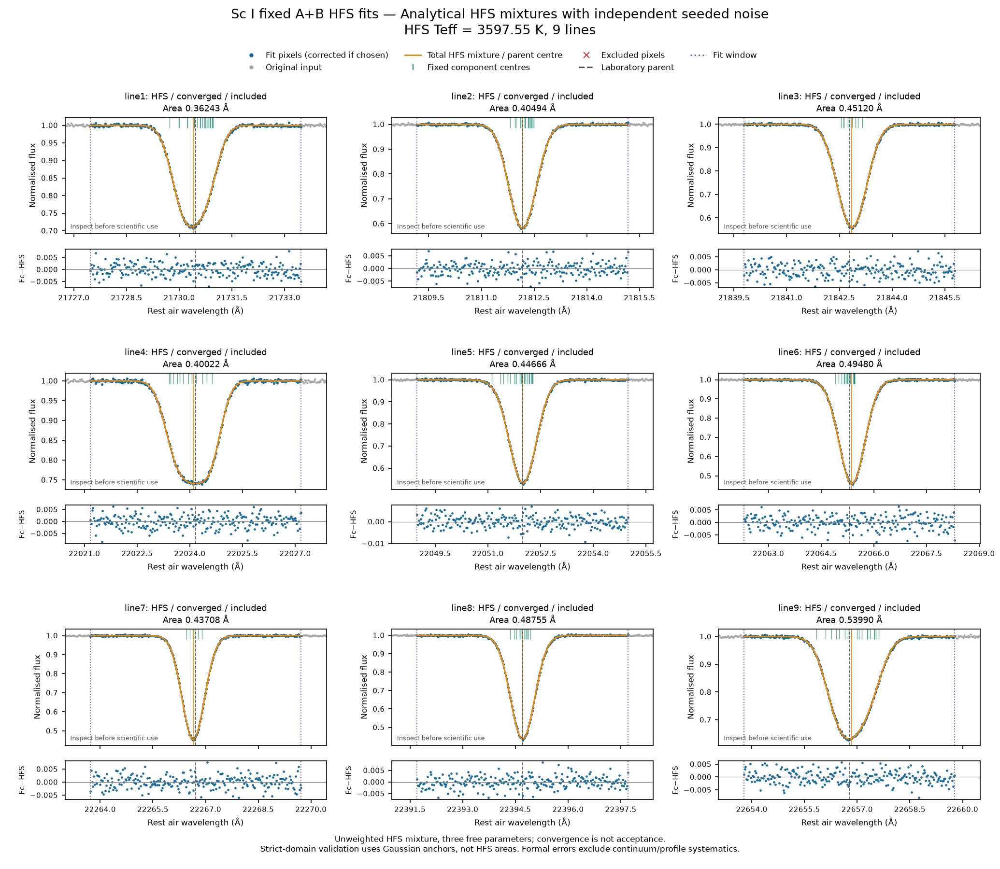
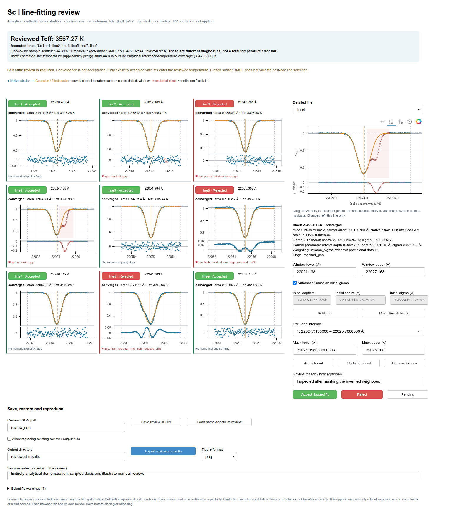
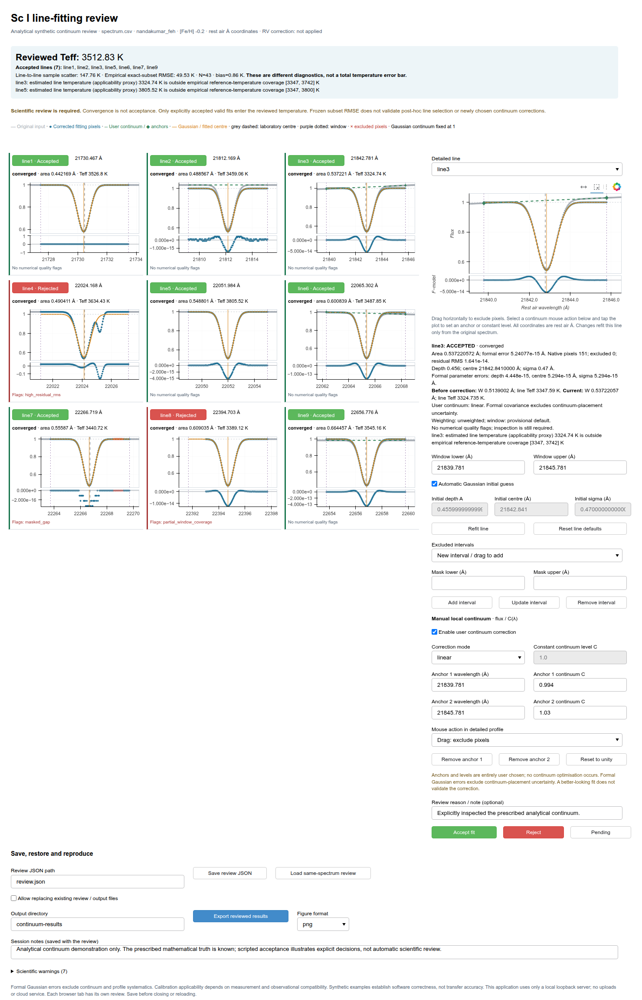
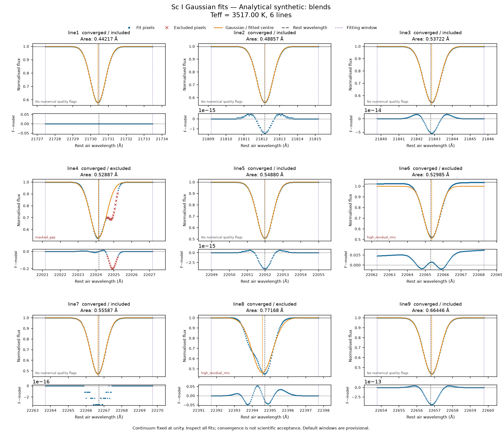

# sc_teff_method

Calculate effective temperatures of cool giant stars from K-band Sc I Gaussian
or hyperfine-structure (HFS) line areas, supplied directly or fitted to your
continuum-normalised spectrum. Each measurement method has its own frozen
**5 October 2026 nine-line calibration** on the Nandakumar et al. (2023)
temperature scale. The measured-area API needs only Python 3.11 or later;
optional spectrum fitting uses NumPy, SciPy and Matplotlib.

Supply any non-empty subset of `line1` through `line9`. Each line gives a
temperature; the combined estimate is their **unweighted mean**. The main method
uses up to all nine lines. The historical four-line Galactic-centre comparison
is not a default configuration.

## Install

From a checkout of this repository:

```bash
python -m pip install .
python examples/use_measured_areas.py
```

For spectrum fitting and diagnostic figures, install the optional libraries:

```bash
python -m pip install ".[spectra]"
```

For local browser inspection and manual review:

```bash
python -m pip install ".[inspect]"
```

The installed package includes its calibration and validation tables. It runs
offline and needs no access to the private paper repository. This PR does not
publish a PyPI package, GitHub release or archive deposit.

## Fit HFS profiles and use the HFS calibration

The optional `spectra` installation includes the fixed-component HFS engine.
The adopted **`hala2022_ab_generated`** pattern uses Sc-45, I = 7/2, fixed
laboratory A+B constants and 133 components across the nine lines. Only the
common amplitude, parent centre and Gaussian component width are fitted.
Component strengths sum to one; the full analytical area is
`W_HFS = sqrt(2*pi) * amplitude * sigma`.

```bash
python examples/generate_hfs_spectrum.py --output-dir hfs-demo --case noise
sc-teff fit-hfs hfs-demo/spectrum.csv \
  --delimiter , --header --wavelength-column wavelength --flux-column flux \
  --uncertainty-column uncertainty --mask-column exclude \
  --wavelength-unit angstrom --wavelength-frame air --continuum-normalised \
  --feh -0.2 --output-dir hfs-results --label "Analytical synthetic HFS spectrum"
```

The generator uses invented mathematical profiles and reproducible independent
noise (seed 20261025), without observed templates. The command writes precise
`summary.json`, all-nine `lines.csv` and `diagnostics.png`; `--plot-format both`
also writes PDF. Inspect the total HFS profiles, component positions, residuals
and quality flags before interpreting Teff. Existing output directories require
explicit `--overwrite`, and source/configuration files remain protected.

HFS fitting is **unweighted least squares**, matching the reference procedure.
Supplied pixel uncertainties support diagnostics and are scaled with any manual
continuum correction; they do not enable weighting. Numerical convergence is
not scientific acceptance. Failed or unavailable fits never contribute, and
flagged fits are excluded unless `--include-warned` is explicit.

```python
from sc_teff_method import fit_hfs_spectrum, write_hfs_outputs
from sc_teff_method.hfs_synthetic import make_hfs_synthetic_spectrum

toy = make_hfs_synthetic_spectrum("noise")
result = fit_hfs_spectrum(
    toy.wavelength_air_angstrom, toy.flux,
    wavelength_unit="angstrom", wavelength_frame="air", continuum_normalised=True,
    uncertainty=toy.uncertainty, mask=toy.mask, configuration="nandakumar_feh", feh=-0.2,
)
if result.temperature is not None:
    print(result.temperature.temperature_k, result.included_line_ids)
write_hfs_outputs(result, "my-hfs-results", spectrum_label="Analytical synthetic HFS")
```

For already measured HFS areas, use `estimate_hfs_temperature`,
`get_hfs_calibration` and `hfs_subset_performance`. The original measured-area
functions retain their Gaussian meaning. Method-labelled results prevent
accidental cross-use; plain numerical dictionaries rely on your explicit choice
of API. HFS areas must use HFS-specific coefficients. Identical frozen model-ID
strings across the methods do not make their coefficients interchangeable.

**Strict-domain validation uses separate Gaussian-anchor areas, not HFS areas.**
Without a complete passing set of Gaussian anchors, applicability is unknown
or false and is explicitly warned. A displayed frozen subset RMSE is not a
claim of target applicability or a validation of new continuum choices,
post-hoc selection or arbitrary instrumental conditions. The combined Teff
remains the unweighted mean of included individual HFS temperatures.

The Hala & Nave Table 4 positions behave approximately as A-only calculations
for these nine transitions; production uses A+B positions. The positive-A
assignment for line9 and explicit missing-B assumptions remain frozen. Selected
third-party atomic data are attributed under CC BY 4.0, separately from the MIT
software and pending calibration-data permissions. See the
[HFS fitting guide](docs/hfs_fitting.md),
[atomic definitions](docs/hfs_atomic_data.md),
[HFS calibration provenance](docs/hfs_calibration_provenance.md) and
[numerical verification](docs/hfs_verification.md).



This analytical example establishes software correctness. Continuum placement,
blends, saturation, resolving power and measurement compatibility can introduce
systematic differences in astronomical use. Formal HFS covariance includes
amplitude-width covariance but excludes those systematics and calibration
uncertainty. Interactive HFS review is deferred; `inspect` and saved Gaussian
reviews retain their Gaussian meaning.

## Inspect, accept and reproduce line fits

The optional Bokeh interface serves interactive plots and Python callbacks from
**127.0.0.1**, using local assets without cloud services, telemetry, uploads or a
CDN. It reuses the existing Gaussian fitter and frozen calibration APIs.

```bash
python examples/demo_interactive_review.py --output-dir review-demo
sc-teff inspect review-demo/spectrum.csv \
  --delimiter , --header --wavelength-column wavelength --flux-column flux \
  --uncertainty-column uncertainty --mask-column exclude \
  --wavelength-unit angstrom --wavelength-frame air --continuum-normalised \
  --feh -0.2 --save-review review.json --output-dir reviewed-results \
  --label "Analytical synthetic review"
```

Inspect all nine profile/residual panels, then select a line for a larger view.
Adjust its fitting window and initial parameters, drag across the profile to add
a mask, or edit mask boundaries numerically. Only the selected line is refitted
from the original in-memory spectrum. The Gaussian model keeps a continuum of
unity; optional **manual local continuum adjustment** first divides a working
copy of flux and supplied pixel uncertainty by your chosen constant or straight
line. The original spectrum is unchanged and corrections never accumulate.

In the detailed view, enable continuum adjustment, choose constant or linear,
and enter a level or two rest-air-Å anchors. Mouse placement and numerical edits
are supported. Original flux, corrected fit pixels, the chosen continuum and
corrected residuals have separate labels. Compare the line area and temperature
before/after, then explicitly accept the revised measurement. Resetting to unity
or changing any continuum control also clears prior acceptance.

**Only explicitly Accepted, valid fits enter the reviewed temperature.** Pending
and Rejected lines do not contribute. Convergence never means scientific
acceptance. A flagged fit can be accepted deliberately, retaining its flags and
an optional reason; failed/unavailable fits cannot be accepted. Editing or
refitting a line invalidates its previous acceptance. No accepted lines means a
missing temperature, not zero. Line scatter and empirical RMSE remain distinct.

Save review JSON before closing. It contains checksums, portable input/parser/RV
conventions, controls, decisions and notes, without embedding the spectrum.
Resume or reproduce it with the same unchanged input:

```bash
sc-teff inspect review-demo/spectrum.csv --review-file review.json
sc-teff replay review-demo/spectrum.csv --review-file review.json \
  --output-dir final-results --plot-format both
```

Replay needs the `spectra` extra but no browser/Bokeh. It restores saved controls,
checks the source checksum, recalculates fits and exports `review.json`,
`summary.json`, `lines.csv` and diagnostic PNG/PDF files. Identical input copies
can be moved or renamed; stale source bytes or accepted controls/results are
rejected. Existing output directories require explicit overwrite permission;
source/configuration files remain protected. The original `fit --fit-config`
workflow remains available.

**Frozen subset RMSE does not validate arbitrary post-hoc manual selection or
newly chosen continuum corrections.**
Review cannot guarantee an unbiased result. Formal Gaussian errors exclude
continuum/profile systematics; accuracy depends on measurement and observational
compatibility. The analytical demonstration establishes software correctness,
not transfer accuracy for arbitrary instruments.

See the [interactive review guide](docs/interactive_review.md) for the complete
exercise, review-file rules and tests.



For the continuum exercise, generate a separate fully analytical spectrum:

```bash
python examples/demo_continuum_review.py --output-dir continuum-demo --scripted-review
sc-teff inspect continuum-demo/spectrum.csv --review-file continuum-demo/review.json
sc-teff replay continuum-demo/spectrum.csv --review-file continuum-demo/review.json \
  --output-dir continuum-results --plot-format both
```

It includes invented unity/constant/sloped continua, a neighbouring blend,
masked/incomplete coverage and deliberately incorrect anchors. Review JSON
version 2 records continuum controls and configurable warning thresholds;
version 1 reviews remain readable with the original unity continuum. Replay
recalculates all measurements from the unchanged, checksum-verified source.



The input must still be approximately continuum-normalised. These entirely
user-controlled corrections do not reproduce the paper's continuum procedures.
Continuum placement influences Gaussian areas and may introduce systematic
differences from the empirical calibration's measurement definition. Formal
Gaussian covariance excludes continuum-placement uncertainty. The user is
responsible for evaluating the anchors; an improved-looking fit does not
establish a more accurate temperature. Analytical tests establish numerical
correctness, not accuracy for other instruments.

## Fit a prepared spectrum

Inputs must contain **air wavelengths in Å** and flux already normalised to a
continuum of unity. The package does not infer units or air/vacuum convention,
normalise the continuum, infer radial velocity or read FITS files. Arrays must
have increasing positive finite wavelengths. Nonfinite flux or uncertainty is
allowed only at pixels you explicitly mask; mask `True` means exclude.

Generate six entirely analytical examples, then run the command-line workflow:

```bash
python examples/generate_synthetic_spectra.py --output-dir synthetic_examples
sc-teff fit synthetic_examples/clean.csv \
  --delimiter , --header --wavelength-column wavelength --flux-column flux \
  --mask-column exclude --wavelength-unit angstrom --wavelength-frame air \
  --continuum-normalised --feh -0.2 --output-dir synthetic_fit \
  --label "Analytical synthetic spectrum"
```

For your own whitespace ASCII file, column indices are zero based (default
wavelength=0, flux=1). CSV requires an explicit delimiter; named columns require
`--header`. Use `--uncertainty-column` for absolute pixel flux standard deviations
and `--mask-column` for a numeric `0=use, 1=exclude` column. Full-line `#` comments
are supported; missing fields, empty data rows and unordered grids are rejected.

The command creates `summary.json`, `lines.csv` and `diagnostics.png` in a new
directory. JSON records the calibration, input hash/parser settings, RV correction,
fit options, windows, initial overrides, exclusions, areas/errors/flags, per-line
temperatures, actual included subset and its held-out statistics. CSV retains all
nine line outcomes. Missing results are JSON `null` or empty CSV cells, never zero.
Use `--plot-format pdf` or `both` for PDF output. Existing directories are refused
unless you explicitly pass `--overwrite`; unrelated files are retained.

**Open the diagnostic figure and inspect the fits before interpreting Teff.**
Every panel shows the input pixels, model, excluded pixels, rest/fitted centres,
window boundaries, residuals, status and area. Numerical convergence is not
scientific acceptance. Failed or unavailable fits cannot contribute; converged
fits with numerical quality flags are excluded by default. After inspection,
`--include-warned` explicitly permits those flagged fits. `--exclude-line line4`
always excludes a selected line. Calibration extrapolation warnings remain
separate and retain the PR 1 behaviour described below.

No velocity correction is applied unless you supply `--rv-kms`. Positive velocity
means recession/redshift: `lambda_rest = lambda_input / sqrt((1+v/c)/(1-v/c))`,
with `c=299792.458 km/s`. Flux is not interpolated. For the generated RV example,
pass `--rv-kms 65`. All windows, centre guesses and exclusion intervals refer to
the corrected **rest-frame air-Å** grid.

The array API makes the same input declarations explicit:

```python
from sc_teff_method import fit_spectrum, write_fit_outputs
from sc_teff_method.synthetic import make_synthetic_spectrum

toy = make_synthetic_spectrum("noise")  # mathematical Gaussians; fixed seed
analysis = fit_spectrum(
    toy.wavelength_air_angstrom, toy.flux,
    wavelength_unit="angstrom", wavelength_frame="air", continuum_normalised=True,
    uncertainty=toy.uncertainty, mask=toy.mask, rv_kms=toy.rv_kms,
    configuration="nandakumar_feh", feh=-0.2,
    quality_policy="exclude_warned",
)
for line_id, fit in analysis.fits.items():
    print(line_id, fit.status, fit.area_angstrom, fit.flags)
if analysis.temperature is not None:
    print(analysis.temperature.temperature_k, analysis.included_line_ids)
    print(analysis.performance.n_stars, analysis.performance.bias_k, analysis.performance.rmse_k)
write_fit_outputs(analysis, "my_synthetic_fit", spectrum_label="Analytical synthetic: noise")
```

`load_spectrum(...)` returns a prepared `Spectrum`; pass it to
`estimate_from_spectrum(...)` without applying RV twice. The workflow supports
both frozen configurations, with explicit [Fe/H] required only by
`nandakumar_feh`. Any surviving non-empty subset is calibrated through the unchanged
PR 1 API. If none survives, the temperature and validation result remain missing;
the CLI still saves diagnostics and returns exit code 3 (invalid input returns 2).

Default windows are **provisional symmetric ±3 Å intervals**, with continuum fixed
to one, bounded amplitude/centre/width and unweighted least squares. They are not
copied from individual stars or observationally approved. Override each window
with `--window LINE:LOWER:UPPER`, an initial guess with
`--initial LINE:AMPLITUDE:CENTRE:SIGMA`, and contaminated pixels with
`--exclude-region LINE:LOWER:UPPER`. A JSON `--fit-config` or Python `FitOptions`
controls bounds and diagnostic thresholds. Supplying pixel uncertainties enables
inverse-sigma weighting and absolute formal covariance; transfer from the original
unweighted measurements requires scientific assessment.

Continuum errors, blends, resolution and the choice of fitting window change
Gaussian areas. Good numerical fits do not establish reliable temperatures.
The empirical calibration remains tied to the observational conditions described
in the manuscript. Analytical synthetic tests establish numerical correctness,
**not transfer accuracy for arbitrary instruments or populations**. Formal fit
errors omit continuum, profile and calibration systematics; line scatter is not
the total temperature uncertainty.

See [the fitting guide](docs/spectrum_fitting.md) for model/error definitions,
flags, complete defaults, configuration examples and synthetic verification.



This illustrative figure uses invented Gaussian profiles, noise-free mathematical
blends and an explicit pixel exclusion. It contains no observational spectrum.

## Use your measured areas

```python
from sc_teff_method import estimate_temperature, subset_performance

# Illustrative Gaussian areas in Angstrom; these are not observed measurements.
result = estimate_temperature(
    {"line1": 0.30, "line2": 0.27},
    configuration="nandakumar_feh",
    feh=-0.2,
)

print(result.temperature_k)          # 3648.659937687841
print(dict(result.line_temperatures_k))
print(result.used_line_ids)          # ('line1', 'line2')
print(result.n_lines)                # 2
print(result.line_scatter_k)         # 30.880647035312226; diagnostic only
print(result.calibration_id)         # '2026-10-05-nine-line-v1'
for warning in result.warnings:
    print(warning.code, warning.line_id, warning.message)

performance = subset_performance(
    result.used_line_ids,
    configuration=result.configuration,
    scope="strict_strength_domain",
    cohort="exact_subset",
)
print(performance.n_stars)           # 44
print(performance.bias_k)            # -1.0468992999376239
print(performance.rmse_k)            # 51.379990357673506
```

These validation statistics are **not an error bar** on the example temperature.
Bias means Sc I prediction minus reference temperature. RMSE is the root mean
square of those residuals, including the bias.

Choose the calibration that matches the information available:

| Configuration | Frozen equation for each line | [Fe/H] input |
| --- | --- | --- |
| `nandakumar_feh` | `T = a * W + b * [Fe/H] + c` | Required, in dex |
| `nandakumar_no_feh` | `T = a * W + c` | Optional for coverage checks only |

The metallicity-free relation was fitted independently. Setting [Fe/H] to zero
in `nandakumar_feh` does not give that relation.

```python
without_feh = estimate_temperature(
    {"line1": 0.30, "line2": 0.27},
    configuration="nandakumar_no_feh",
)
print(without_feh.temperature_k)     # 3623.3789081217
```

`W` must be the positive analytic absorption area of a Gaussian fitted to a
continuum-normalised line, in **Å**, with the area definition used by the
calibration. For a Gaussian absorption depth `A` and width `sigma` in Å,
`W = sqrt(2*pi) * A * sigma`, integrated over the full Gaussian. Finite-band
equivalent widths, HFS-fit areas and other measurement definitions are not
interchangeable with these coefficients. Convert mÅ to Å before calling the API.

Omit unavailable lines from the mapping. Zero, `None`, blank strings and NaN
are rejected; none is used as a missing-value substitute. Booleans, complex
numbers, unknown IDs, empty input and non-finite values are also rejected.
The API uses every supplied positive, finite area, including extrapolations;
it never clips values or silently discards lines. Results list contributing
lines in canonical order.

| Line ID | Air wavelength (Å) | Line ID | Air wavelength (Å) | Line ID | Air wavelength (Å) |
| --- | ---: | --- | ---: | --- | ---: |
| `line1` | 21730.467 | `line4` | 22024.168 | `line7` | 22266.719 |
| `line2` | 21812.169 | `line5` | 22051.984 | `line8` | 22394.703 |
| `line3` | 21842.781 | `line6` | 22065.302 | `line9` | 22656.776 |

## Applicability and warnings

The **declared Gaussian-strength selection cut is inclusive `W >= 0.08 Å`**,
with no declared upper strength cut. It is separate from each line's empirical
full-sample training-strength range. Passing that cut does not establish that
an area is within the training range. For example, `line1=0.08` passes the
selection cut but lies below its empirical training minimum of about 0.1016 Å.

`estimate_temperature` returns separate warnings for areas below the declared
cut and areas outside the empirical training range. It also checks the empirical
reference-temperature and metallicity coverage for each supplied line. These
are marginal coverage checks, not a guarantee of joint support or validity.

The retained reference temperatures span 3347–3800 K and [Fe/H] −0.92 to +0.25
for most lines. `line3` has narrower coverage: 3347–3742 K and −0.66 to +0.25 dex.
When an independent temperature is available, pass `reference_temperature_k`
to check that value. Otherwise each estimated line temperature is checked as
an **applicability proxy**, not a known reference temperature. This check never
controls line availability. The metallicity-free configuration can check
metallicity coverage only if the optional `feh` is supplied; that value never
enters its temperature equation.

Inspect the exact per-line coefficients and ranges with:

```python
from sc_teff_method import get_calibration

calibration = get_calibration("nandakumar_feh")
print(calibration.lines["line3"])
```

Warnings have stable `code`, `line_id` and `message` attributes. Codes are
`outside_declared_strength_cut`, `outside_training_strength_range`,
`outside_reference_temperature_range` and `outside_reference_feh_range`.
They are returned in `result.warnings`, not emitted by Python's warnings module.

Applicability also depends on the reference scale, continuum definition,
resolving power, blends and measurement procedure. The source calibration uses
IGRINS measurements of cool giants. This API does not validate or correct a
new instrument, measurement procedure or stellar population.

## Subset validation and uncertainty

The package contains all **511 non-empty fixed subsets**, for both
configurations, two scopes and two cohorts: 4,088 validation records.

| Option | Meaning |
| --- | --- |
| `scope="strict_strength_domain"` | Retain held-out predictions passing the declared Gaussian-anchor strength cut. |
| `scope="all_available"` | Retain finite held-out predictions irrespective of that cut. |
| `cohort="exact_subset"` | Include every reference star with all requested lines usable. |
| `cohort="common_all9"` | Evaluate every subset on the same complete-nine-line reference cohort for that model and scope. |

Both scopes happen to give identical statistics in this frozen Gaussian sample;
their definitions remain distinct. Neither scope imposes the empirical training
ranges. `scope` and `cohort` select validation records; they do not filter a
target's supplied areas. If a target area is below 0.08 Å, strict-domain
validation does not cover that measurement. `all_available` is not evidence
of accuracy for arbitrary extrapolations.

Look up the actual contributing line identity for your target. Exact subsets
containing `line3` have 43 held-out stars; other exact subsets have 44.
Every `common_all9` cohort has 43 stars. Exact-nine validation therefore differs
from a population estimate that uses eight or nine lines per star. For example,
the exact-nine metallicity-dependent RMSE is about 48.95 K on 43 stars; the
reference variable-availability result is about 50.19 K on 44 stars. The latter
is documented for context and is not the lookup result for `line1`–`line9`.

Validation uses saved leave-one-star-out predictions. Bias and RMSE are
**empirical predictive statistics relative to the Nandakumar reference scale**,
not formal measurement uncertainties, absolute temperature accuracy or universal
per-star uncertainties. The line errors are correlated. The sample standard
deviation of the line temperatures (`line_scatter_k`, `ddof=1`) measures only
their internal disagreement; it is `None` for one line. Neither that scatter
nor scatter divided by `sqrt(n_lines)` gives the total uncertainty in the mean.
The API does not propagate measurement errors or fit a calibration confidence
interval. Do not select a supposedly best subset after inspecting these RMSE
values without separate selection validation.

## Provenance, citation and scope

The frozen coefficients are unchanged. The compact numerical export records
the source snapshot, source revisions, SHA-256 hashes and projection rules in
[docs/provenance.md](docs/provenance.md) and the packaged `provenance.json`.
The two Gaussian and two HFS configurations have separate numerical exports and
validation summaries. The HFS projection and selected atomic data are documented
in [the HFS provenance guide](docs/hfs_calibration_provenance.md) and
[atomic-data guide](docs/hfs_atomic_data.md).

[CITATION.cff](CITATION.cff) identifies this software using the verified repository
author. The reference temperature scale is described by
[Nandakumar et al. (2023), A&A 675, A23](https://doi.org/10.1051/0004-6361/202346149).
That reference describes the temperature scale, not a new DOI for this Sc I
calibration. The final calibration-paper citation and public data-release
identifier remain TODO/VERIFY; neither is invented here.

The [MIT software licence](LICENSE) is retained. See
[DATA_NOTICE.md](DATA_NOTICE.md) for the limited numerical export and pending
calibration-data attribution/permission checks and separate CC BY 4.0 atomic-data
attribution. No additional calibration-data licence or co-author permission is
assumed.

The original measured-area API and its approved frozen numerical products are
preserved. New spectrum examples and tests generate analytical Gaussian profiles
and HFS mixtures at run time, using invented parameters and fixed noise seeds.
**No observational spectra, extracts, wavelength–flux arrays or observed spectral
plots are included or used for development.** Committed spectral figures and the
interface preview come from analytical examples only. FITS input, automatic continuum finding,
higher-order continuum polynomials, interactive HFS review, rectangular-band
measurements, stellar spectral synthesis, calibration refitting and new
observational validation are outside scope.

## Development

```bash
python -m pip install -e ".[dev]"
python -m pytest -q
python -m ruff check .
python -m build
```

Public tests run without the private repository. They include fixed regressions
from the reference estimator, every subset identity and option combination,
all subset temperature means, input validation, boundary warnings and data
integrity checks. GitHub Actions builds distributions and runs the tests and
examples against the installed wheel on Python 3.11 and 3.14. The spectral tests
use analytical data exclusively and check Gaussian parameter/area recovery,
independent covariance calculations, both RV signs, masks/gaps/failed fits,
inclusion policies, CLI output precision and overwrite protection. Install the
`dev` extra to run both the original and spectral tests. With the base `test`
extra alone, the original tests run and spectral tests skip their unavailable
optional dependencies.
